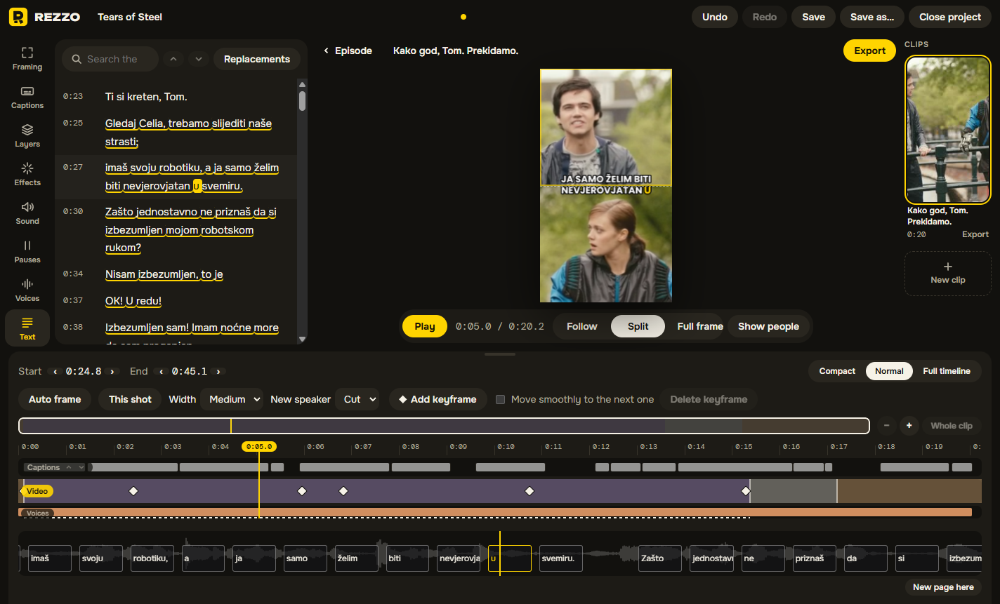
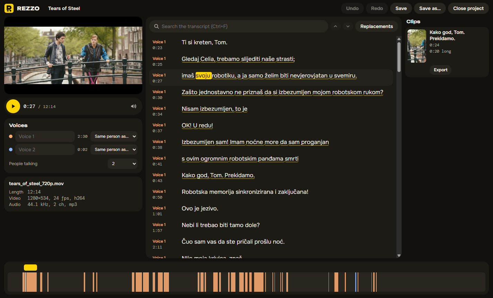

# Rezzo

Rezzo is a desktop app for cutting vertical clips out of podcasts and talk shows.

I post podcast clips on social media, and the work is the same every time: find a good moment, crop a wide shot down to 9:16, keep whoever is talking in frame, add captions. The apps that handle this well either stamp a watermark on the video or put the useful parts behind a monthly subscription. Rezzo does the same job for free, and every feature is in the free version because there is no other version.

It's made for Serbian, Croatian and Bosnian shows first, since that's what I work with.



## Download

Windows only for now. Get the installer from the [Releases page](https://github.com/dzonyv/rezzo/releases/latest) and run it. It installs for your user and doesn't need administrator rights.

The installer isn't signed yet, so Windows SmartScreen warns you the first time. Click "More info", then "Run anyway".

An NVIDIA graphics card makes transcription and export a lot faster, but it isn't required. Without one, both run on the processor. The first time you transcribe, Rezzo downloads whisper.cpp and the speech model (about 1.3 GB with an NVIDIA card) into `%LOCALAPPDATA%\Rezzo`. Uninstalling leaves them there, so a reinstall doesn't download them again. "Disk space" on the home screen shows what Rezzo keeps there and lets you delete it.

## How it works

You start with a whole episode. Pick the language (Serbian, Croatian or Bosnian) and Rezzo transcribes it with a time for every word, always in Latin script, even if the speech model hands back Cyrillic. While the video plays you can search the transcript, and fix the words Whisper got wrong one after another from the keyboard. Words it always gets wrong (it writes "futbal" every single time) go on a replacement list, and every new transcript gets them fixed.



Select a few sentences and they become a clip. Rezzo tells the voices in the episode apart, and when you open a clip it looks for camera cuts and people. Press Auto frame and you get one of three layouts for each shot: following the person talking, two people stacked on top of each other (Split), or the whole picture over a blurred copy of itself. What it does is ordinary keyframes, so you can change any of it by hand. On a wide shot it can't tell who is talking by itself, so turn on Show people and click whoever is. That one click teaches it where that voice sits for the rest of the episode. It goes by the sound and the camera cuts, because lips turned out to be no use for this on real footage.

Every clip gets captions that appear word by word and mark the word being spoken. There are a few built-in styles, and you can change the font, colours, outline, size and how many words fit on a line, then keep the result as your own style. Poppins Bold is the default because it's what I always use. Montserrat and Anton come with the app too, and you can add any TTF or OTF font you have.

Pauses can go if you want them gone. Rezzo finds them in the sound and marks them on the timeline, so you see what would be cut before anything is, and you can keep the ones you like. Select words in the transcript and they come out the same way, which is handy for an "ovaj" or a false start. Nothing happens to the episode itself, and a cut comes back with a click.

On top of the picture go layers, each on its own row of the timeline: images that pop, slide, zoom or bounce in; videos, with a transparent background or a green screen to take out; Lottie animations; and effects like a zoom punch, a flash, colour changes or film grain. Images and videos stay where they are on your disk, the same as the episode. If you move one, Rezzo asks where it went.

Sounds are layers too, on rows of their own under the picture. There's a small library of free sound effects (a click, a camera shutter, a whoosh and so on), or use your own files and music. A sound can go with a layer coming in or going out, so it moves when the layer does. The loudness of the clip and of your own files is evened out to the same level. Music gets quieter by itself while someone talks and comes back up in the gaps.

Export makes a 1080×1920 MP4, on the graphics card when there is one, with no watermark. The preview and the export use the same renderer, so the file looks like what you saw while editing.

## Building it yourself

You need Windows and Node 24.

```
npm install
npm run fetch-tools
npm run dev
```

`fetch-tools` puts FFmpeg, the voice tools and the pose and face models in `vendor/`. `npm run check` runs the linter, the type checker and the unit tests, and `npm run test:e2e` builds the app and drives it with Playwright. `npm run dist` builds the installer into `release/`.

## Under the hood

Electron, React and TypeScript. FFmpeg comes with the app, whisper.cpp does the transcription, MediaPipe finds people and faces, and sherpa-onnx tells voices apart. A single WebGL renderer draws both the preview and the export. Before any of it was built I checked that the hard parts work on an ordinary PC; what I found is in [spikes/REPORT.md](spikes/REPORT.md). What comes next is in [ROADMAP.md](ROADMAP.md). macOS and Linux are on that list.

## Contributing

Issues and ideas are welcome. The project's rules are in [CLAUDE.md](CLAUDE.md). The most important one: never commit podcast or show footage. Anything used for testing has to be openly licensed.

## License

[GPL-3.0](LICENSE)

The screenshots show frames from *Tears of Steel*, (CC) Blender Foundation | mango.blender.org, under CC BY 3.0, with the film's Croatian subtitles standing in for a transcript. Details are in [docs/screenshots/CREDITS.md](docs/screenshots/CREDITS.md).
